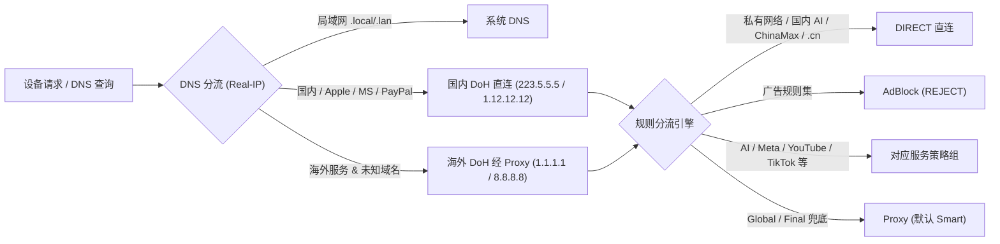

<div align="center">


<br /><br />

<h3>为 iPhone 打造的 Egern &amp; Loon 极简分流配置</h3>

<p>国内站点直连 · 海外 AI 独立聚合 · 全量 Real-IP 零泄露 DNS · 开箱即用去广告</p>

<p>
  <a href="Egern.yaml"></a>
  <a href="Loon.conf"></a>
  <a href="plugin/ip-attribution.yaml"></a>
  <a href="plugin/LICENSE"></a>
</p>

<p>
  <a href="#快速开始"><strong>快速开始</strong></a>
  &nbsp;&nbsp;|&nbsp;&nbsp;
  <a href="#egern-配置"><strong>Egern 配置</strong></a>
  &nbsp;&nbsp;|&nbsp;&nbsp;
  <a href="#loon-配置"><strong>Loon 配置</strong></a>
  &nbsp;&nbsp;|&nbsp;&nbsp;
  <a href="#ip-归属地规则"><strong>IP 归属地</strong></a>
  &nbsp;&nbsp;|&nbsp;&nbsp;
  <a href="#上游致谢"><strong>上游致谢</strong></a>
</p>

</div>

---

## 核心特性

<table>
  <tr>
    <td width="50%" valign="top">
      <strong>🔒 全量 Real-IP 零泄露 DNS</strong><br />
      <sub>纯 IP 加密 DoH 分流，海外服务优先走 Cloudflare / Google DoH（经代理），国内与默认直连走阿里 / 腾讯 DoH，节点解析直连国内加密 DNS，无明文泄露。</sub>
    </td>
    <td width="50%" valign="top">
      <strong>⚡ 智能倍率选优 + 自动测速</strong><br />
      <sub><code>Smart</code> 组按延迟、抖动与成功率综合评分，并自动区分 <code>&lt;1x（含 0x）</code>、<code>1x</code>、<code>&gt;1x</code> 三档倍率权重；五大主力地区每 10 分钟自动测速选优。</sub>
    </td>
  </tr>
  <tr>
    <td width="50%" valign="top">
      <strong>🤖 AI 与主流服务精细分流</strong><br />
      <sub>DeepSeek、豆包等国内 AI 自动直连；ChatGPT、Claude、Gemini、Grok、Cursor、Copilot 等海外 AI 独立聚合；覆盖 Meta 四件套、YouTube、TikTok、Netflix 等。</sub>
    </td>
    <td width="50%" valign="top">
      <strong>🛡️ 开箱即用去广告与增强</strong><br />
      <sub>Egern 主配置内置 13 个精选模块（含 App 去广告、YouTube 增强、iRingo WeatherKit 与 IP 归属地分流），统一 24 小时自动更新。</sub>
    </td>
  </tr>
</table>

---

## 快速开始

两份主配置独立维护，版本号写在各自文件首行。直接复制对应 Raw 地址导入客户端即可：

| 适用 App | 文件 | 版本 | 远程导入地址 |
| :--- | :--- | :---: | :--- |
| **Egern** | [`Egern.yaml`](Egern.yaml) | `3.1` | `https://raw.githubusercontent.com/amilokane/Loondrift/main/Egern.yaml` |
| **Loon** | [`Loon.conf`](Loon.conf) | `1.0.3` | `https://raw.githubusercontent.com/amilokane/Loondrift/main/Loon.conf` |
| **Egern 模块** | [`plugin/ip-attribution.yaml`](plugin/ip-attribution.yaml) | — | 已内置于 `Egern.yaml`，无需单独导入 |
| **Loon 插件** | [`plugin/ip-attribution.plugin`](plugin/ip-attribution.plugin) | — | `https://raw.githubusercontent.com/amilokane/Loondrift/main/plugin/ip-attribution.plugin` |

---

## Egern 配置

### 1. 导入与初始化

在 Egern 首页选择 **从 URL 导入**，粘贴下方链接：

```text
https://raw.githubusercontent.com/amilokane/Loondrift/main/Egern.yaml
```

1. **添加订阅**：导入自己的 Egern 兼容订阅，会自动归入隐藏的 `Airport` 组，并自动剔除流量、到期、官网、群组等非节点提示条目。
2. **切换节点**：首页最上方即为 `Proxy` 与 `Manual`，日常手动切节点一滑即达；`Proxy` 默认使用 `Smart`，绝大多数海外服务初始跟随 `Proxy`。
3. **开启 MitM**：在 Egern 中生成、安装并在 iOS 系统中信任证书，开启全局 MitM，App 去广告、YouTube 增强与 WeatherKit 重写即可生效。

> [!NOTE]
> `Smart` 依赖 Egern 的 `smart` 策略组类型。若导入报错或 `Smart` 无节点，请先将 Egern 升级至支持该类型的最新版本。

### 2. 分流与 DNS 工作流



### 3. 策略组结构（共 25 个可见组）

按日常操作频率自上而下排布，高频总控置顶、底层测速池与系统工具收尾：

| 层级 | 策略组 | 默认策略 | 用途说明 |
| :--- | :--- | :---: | :--- |
| **总控入口** | `Proxy` · `Manual` | `Smart` / 全节点 | 主代理出口与全部节点手动选择，置顶方便随时切换 |
| **高频常切** | `AI` · `YouTube` · `TikTok` · `Telegram` · `Discord` | `Proxy`（TikTok 默认 `Japan`） | 聚合海外 AI（ChatGPT / Claude / Gemini / Grok / Cursor / Copilot 等）与日常高频切区服务 |
| **常用海外** | `Twitter` · `Meta` · `Netflix` · `Spotify` · `Google` · `GitHub` | `Proxy` | `Meta` 完整覆盖 Threads、Facebook、Instagram、WhatsApp |
| **默认直连** | `Apple` · `Microsoft` · `PayPal` | `DIRECT` | 默认直连降低延迟与风控，需要时可在组内切代理 |
| **系统兜底** | `AdBlock` · `Final` | `REJECT` / `Proxy` | 广告总开关与未命中兜底出口 |
| **节点池** | `Smart` · `Hong Kong` · `Japan` · `United States` · `Singapore` · `Taiwan` · `Other Regions` | 自动优选 / 手动 | 五大主力地区自动测速（600s / 5s / 50ms 容差），其余地区归入 `Other Regions` |

> [!TIP]
> ChatGPT、Claude、Gemini 等主流海外 AI 屏蔽香港节点。当 `Smart` 选中香港时，直接在 `AI` 组切到 `Manual` 或美/日/新/台地区组即可。

<details>
<summary><strong>📐 展开查看：Smart 倍率权重与节点识别规则</strong></summary>

<br />

`Smart` 综合延迟、抖动和成功率对节点打分，再乘以倍率系数（**系数越小越优先**）：

| 节点名称特征 | 系数 | 调度效果 |
| :--- | :---: | :--- |
| 低于 1 倍（含 0 倍），如 `0.5x`、`x0.8`、`0.2倍`、`0x`、`0.5` | `0.1` | 优先选用 |
| 1 倍或未标倍率，如 `1x`、`1.0倍`、普通节点 | `1` | 正常参与 |
| 高于 1 倍或含「高倍」，如 `1.5x`、`2x`、`倍率:3` | `10` | 尽量避开 |

- 高倍率（`>1`）与低倍率（`<1`）正则严格互斥；`v0.8` 等版本号会被自动忽略。
- 名称带「直连」或 `DIRECT` 的节点不参与 `Smart` 自动选择，可在 `Manual` 或地区组中手动指定。
- 五大地区支持旗帜、繁简中英文地名、机场三字码（如 `LAX`、`HND`、`SIN`、`TPE`）及中转简称（如 `沪港`、`深日`、`广美`）。

参考文档：[Egern 策略组文档](https://egernapp.com/zh-CN/docs/configuration/policy_groups)

</details>

<details>
<summary><strong>🌐 展开查看：DNS 解析与零泄露架构</strong></summary>

<br />

Egern 启用 `real_ip_domains: ['*']` 与 `hijack_dns: ['*']`，接管全部系统 DNS 查询并返回真实 IP，杜绝 Fake-IP 场景下的系统旁路回退：

| 域名范围 | 上游 DNS | 连接方式 |
| :--- | :--- | :---: |
| 本地域名（`.local`、`.lan`、`.localdomain`、`.home.arpa`） | 系统 DNS | 当前网络 |
| 国内 AI、`ChinaMax`、`.cn`、Apple、Microsoft、PayPal | 阿里 / 腾讯 DoH（`223.5.5.5`、`1.12.12.12`） | `DIRECT` |
| 全部海外服务规则集与其他未知域名 | Cloudflare / Google DoH（`1.1.1.1`、`8.8.8.8`） | 经 `Proxy` |
| 代理节点自身域名（`proxy_nameservers`） | 阿里 / 腾讯 DoH（`223.5.5.5`、`1.12.12.12`） | 强制直连 |

- 所有 DoH 上游均使用纯 IP 地址，无需明文查询上游域名；`bootstrap` 使用 `223.5.5.5` 与 `119.29.29.29`，不含运营商明文 `system` DNS。
- YouTube、TikTok、海外 AI、Google、GitHub、Telegram、Discord、Twitter、Meta、Netflix、Spotify 规则集均排在国内集合之前，确保始终走海外 DoH。

参考文档：[Egern DNS 文档](https://egernapp.com/zh-CN/docs/configuration/dns)

</details>

<details>
<summary><strong>🧩 展开查看：内置 13 个 Egern 模块（默认全部启用）</strong></summary>

<br />

全部模块统一 `update_interval: 86400`（24 小时自动更新），HTTPS 解密范围仅限各模块自身声明的域名：

| 分类 | 已内置模块 |
| :--- | :--- |
| **综合与 App 去广告** | 去广告合集（`blockAds`）、微博去广告&净化、哔哩哔哩、百度贴吧、斗鱼直播、闲鱼、淘宝、拼多多、网易云音乐、懂球帝 |
| **功能增强与工具** | YouTube 增强、iRingo WeatherKit、IP Attribution |

参考文档：[Egern 模块文档](https://egernapp.com/zh-CN/docs/configuration/modules)

</details>

---

## Loon 配置

### 1. 导入与更新

在 iPhone 的 Loon 中打开 **配置 → 从 URL 导入**，粘贴：

```text
https://raw.githubusercontent.com/amilokane/Loondrift/main/Loon.conf
```

1. 添加自己的节点订阅，并在「默认代理」中选择可用节点或策略组。
2. 切换至规则模式；AI、YouTube 等子服务均可在各自策略组独立指定出口。

> [!TIP]
> **从旧版更新时**，请关闭「全覆盖更新」以保留本地节点、订阅与证书；更新完成后刷新远程规则和插件即可。

### 2. 策略组概览

| 策略组 | 初始行为 |
| :--- | :--- |
| **默认代理** | Google、YouTube、Telegram 等海外服务默认跟随此组 |
| **AI** | 海外 AI 初始走「美国」；DeepSeek、豆包等国内 AI 按规则直连 |
| **Apple · Microsoft** | 默认直连，可按需在组内切换节点 |
| **漏网之鱼** | 处理未命中规则的流量，默认走「默认代理」 |

<details>
<summary><strong>⚙️ 展开查看：Loon 选路、去广告与 STUN 排查</strong></summary>

<br />

- **地区与倍率选路**：香港、日本、美国、新加坡、台湾按名称自动筛选并故障转移；其余线路归入「其他节点」；「自动优选」自动过滤高倍节点；「低倍率节点」与「高倍率节点」支持手动挑线。
- **App 内去广告**：域名广告由「AdBlock」拦截；B 站、YouTube 等 HTTPS 重写插件需在 iOS 安装并信任 Loon 证书。
- **语音 / 联机排查**：配置默认启用 `disable-stun = true`；若语音、视频通话或游戏联机异常，将其改为 `false` 重试。

</details>

---

## IP 归属地规则

将微博、哔哩哔哩、知乎、抖音、小红书等 30+ 常见 App 的 IP 属地查询请求交由指定策略处理。共收录 **242 条规则**（193 条走指定策略 · 28 条直连 · 21 条拒绝），转换自 [SunsetMkt/anti-ip-attribution](https://github.com/SunsetMkt/anti-ip-attribution) 并加入本地补充。

| 客户端 | 文件 | 使用方式 |
| :--- | :--- | :--- |
| **Egern** | [`plugin/ip-attribution.yaml`](plugin/ip-attribution.yaml) | `Egern.yaml` 已内置，默认跟随 `Proxy` 出口（单独导入时可通过参数 `PROXY` 指定策略） |
| **Loon** | [`plugin/ip-attribution.plugin`](plugin/ip-attribution.plugin) | 需单独导入插件，导入后将 `PROXY` 绑定到目标策略组 |

```text
# Egern 独立模块地址
https://raw.githubusercontent.com/amilokane/Loondrift/main/plugin/ip-attribution.yaml

# Loon 插件地址
https://raw.githubusercontent.com/amilokane/Loondrift/main/plugin/ip-attribution.plugin
```

---

## 上游致谢

| 项目内容 | 上游来源 |
| :--- | :--- |
| Egern 主力业务规则 | [Valiumlove/MultiClientProxyCore](https://github.com/Valiumlove/MultiClientProxyCore)（[Lanxu Space](https://lanxu-space.pages.dev/) / MagicRule 每日同步） |
| Egern 国内综合与精简广告 | [Repcz/EgernRules](https://github.com/Repcz/EgernRules)（基于 blackmatrix7 转换原生 YAML） |
| Loon 服务与广告规则 | [blackmatrix7/ios_rule_script](https://github.com/blackmatrix7/ios_rule_script/tree/master/rule/Loon) |
| 国内与海外 AI 规则 | [VPSDance/ai-proxy-rules](https://github.com/VPSDance/ai-proxy-rules) |
| 广告域名补充 | [RiverFlowsInUUU/RFU-Rules](https://github.com/RiverFlowsInUUU/RFU-Rules) |
| Egern 模块来源 | [Egern Hub](https://egern.pages.dev/) · [IBL3ND/module](https://github.com/IBL3ND/module) |
| Loon 插件来源 | [可莉插件中心](https://hub.kelee.one/) |
| IP 归属地规则 | [SunsetMkt/anti-ip-attribution](https://github.com/SunsetMkt/anti-ip-attribution) |
| 策略组图标 | [AIsouler/MyClash](https://github.com/AIsouler/MyClash) |

---

<div align="center">
  <sub><code>plugin/</code> 目录下规则沿用上游 <a href="plugin/LICENSE">GPL-3.0</a> 许可 · 版本规则：每次更新小数位 +1，满 10 进位（<code>2.9</code> 之后为 <code>3.0</code>）</sub>
</div>
